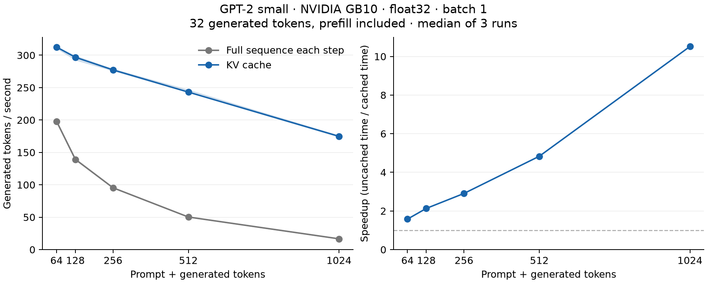
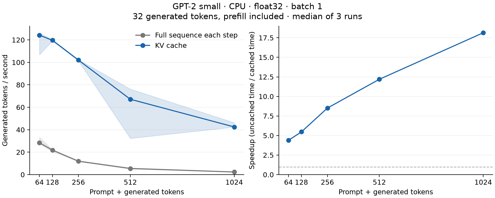

# GPT-2 Inference Engine

GPT-2 small (124M) built from scratch in PyTorch, with Hugging Face's pretrained weights. I wrote the forward pass, vectorized multi-head attention, sampling, and a KV cache, then checked the outputs against Hugging Face and against my own uncached model.

On the GX10's NVIDIA GB10, the KV cache increased generation throughput from **16.63 to 174.84 tokens/sec (10.52×)** for a 992-token prompt and 32 generated tokens. Median time fell from **1.92 s to 0.183 s**, including prefill. The same workload on an Apple M3 Pro CPU improved from **2.34 to 42.49 tokens/sec (18.13×)**.





Both plots use float32, batch-one greedy generation, and median timings from three runs. Each point generates 32 tokens; the rest of the sequence is the prompt. The GPU has higher throughput with and without caching; the CPU has a larger relative cache speedup at the longest length. These ratios compare each device against its own uncached baseline.

Raw timings and environment details are in [results/cuda.json](results/cuda.json) and [results/cpu.json](results/cpu.json). A separate CPU rerun reached **17.72×** at the longest length; its samples are in [results/cpu-repeat.json](results/cpu-repeat.json). Short CPU runs varied more: the 64-token speedup was 4.38× initially and 3.80× on the rerun. The GPU results are from one benchmark invocation with three measured repeats per mode and length.

## Run it

Requires Python 3.14 and [uv](https://docs.astral.sh/uv/).

```bash
uv sync --python 3.14
uv run python -m gpt2_engine.generate
```

The first run downloads GPT-2's pretrained weights. The example uses temperature sampling and the KV cache. To use a different prompt or sampling settings:

```python
from gpt2_engine.model import GPT2
from gpt2_engine.generate import generate

model = GPT2.from_pretrained()
text = generate(
    model,
    "In linear algebra, an eigenvector is",
    temperature=0.7,
    top_k=50,
    top_p=0.9,
    max_new_tokens=40,
    cache=True,
)[0]
print(text)
```

Temperature `0` selects greedy decoding. Set `cache=False` to recompute the full sequence at every step. Empty prompts start from GPT-2's beginning-of-sequence token, ID 50256.

## What I implemented

Token and position embeddings feed into 12 pre-norm transformer blocks. Each block has masked self-attention, an MLP with tanh-approximate GELU, and residual connections. A final LayerNorm and a weight-tied language-model head produce the vocabulary logits.

Attention projects Q, K, and V together, then reshapes each from `(B, T, 768)` to `(B, 12, T, 64)`. Each head computes its own scaled scores and softmax; the head dimension lets PyTorch run them together. The outputs are merged and passed through the output projection.

The loader matches my module names to the checkpoint, transposes Hugging Face's Conv1D weights for `nn.Linear`, and copies them in place. Token embeddings and the LM head share one weight matrix.

Generation supports greedy decoding, temperature, top-k, and top-p sampling. Top-p keeps the smallest sorted group of tokens whose cumulative probability reaches the threshold, including the token that crosses it.

## KV cache

Without caching, every generation step feeds the entire growing sequence through all 12 blocks again. Causal attention means earlier tokens cannot see later ones, so appending a token does not change the earlier tokens' representations. Their keys and values can be reused.

Each attention layer stores its own K and V tensors. The first call processes the full prompt (prefill). Later calls process one new token, append its K and V along the sequence dimension, and use its query to attend over the saved history. The model offsets position embeddings by the number of cached tokens. `generate` resets the history at the start of each call.

Prefill uses a causal mask. During one-token decoding, all available keys belong to earlier positions or the current position, so that query can see all of them.

The cache avoids recomputing old tokens' projections, attention outputs, and MLPs. It still has to compare each new query against the growing key history and combine the saved values. This implementation also concatenates K and V each step, which copies the cache; it does not use a preallocated buffer or fused attention kernels.

The extra memory for batch size B and T cached tokens is:

$$
2 \times n_{\text{layer}} \times B \times T \times n_{\text{embd}} \times \text{bytes per element}
$$

For GPT-2 small in float32 at batch one, that is 73,728 bytes per token, or **72 MiB at 1,024 cached tokens**. This counts K/V tensor storage only; model weights, activations, temporary concatenation allocations, and allocator overhead are separate.

## Verification

```bash
uv run python -m tests.run_checks
```

The latest CPU run passed all five checks. Maximum absolute difference from Hugging Face was **2.86e-6** for block-0 attention and **1.22e-4** for full-model logits on the checked inputs. Greedy generation matched on all three comparison prompts. Full output is in [results/verification-cpu.txt](results/verification-cpu.txt).

All five checks also passed on the GX10 GPU, including exact cached-versus-uncached greedy tokens and all three Hugging Face generation comparisons. The maximum absolute full-model logit difference from Hugging Face was **6.87e-5**. The GPU log is in [results/verification-cuda.txt](results/verification-cuda.txt).

This runs all five checks in separate processes and saves their output to `results/verification-cpu.txt`. Failed assertions cause a nonzero exit status.

- `tests/test_attention.py`: attention output shapes, causality, and agreement with Hugging Face block-0 attention.
- `tests/test_logits_against_hf.py`: full-model logits against Hugging Face, with intermediate block comparisons if they diverge. The absolute-difference threshold is `1e-3`.
- `tests/test_greedy_against_hf.py`: greedy generation against Hugging Face on three prompts, 40 new tokens each.
- `tests/test_sampling.py`: deterministic greedy decoding, seeded sampling, valid probabilities, top-k limits, temperature behavior, and top-p checks.
- `tests/test_kv_cache.py`: cached versus uncached logits (`atol=2e-4`, `rtol=1e-5`), exact greedy token IDs on three prompts and an empty prompt, cache shapes and lengths, reset behavior, and repeated generation. It also checks that cached generation feeds one token per call after prefill.

These are bounded correctness checks, not a claim that every possible prompt has been tested. I kept the scripts because they make the implementation's claims reproducible.

## Benchmark

```bash
uv run python -m benchmarks.benchmark_kv_cache --device cpu --threads 4 --output results/cpu.json
uv run python -m benchmarks.plot_results results/cpu.json --output results/cpu.png
```

Both devices were measured October 23, 2026. The CPU run used an Apple M3 Pro, macOS 26.6.2 (arm64), Python 3.14.7, and PyTorch 2.14.1. The GX10 run used an NVIDIA GB10, Linux 6.17.0-1014-nvidia (aarch64), Python 3.14.8, and PyTorch 2.14.1+cu130 (CUDA 13.0). Both used four PyTorch CPU threads.

The benchmark uses float32, batch size one, greedy decoding, and total sequence lengths of 64, 128, 256, 512, and 1,024. Each prompt is a token-counted prefix of the same repeated text, with 32 additional generated tokens. The longest run therefore has a 992-token prompt.

For each length, both modes get one warmup run, followed by three measured runs each. Their order alternates between repeats. Timings include the prompt forward pass, token selection, sequence concatenation, and 31 subsequent decoding calls. They exclude loading, tokenization, text decoding, and cache reset. GPU timings synchronize CUDA before and after the measured work. Tokens/sec is 32 divided by median elapsed time; the shaded bands show the range across repeats, not confidence intervals. Prefill times and every timing sample are saved in the JSON.

Every measured repeat also checks that the cached and uncached token IDs match exactly.

The cached line still falls as sequence length grows: the prompt takes longer to process, and decoding reads a longer K/V history. At the longest length, the cached CPU run spent about 0.38 s of its 0.75 s in the prefill portion. On the GPU, the corresponding prefill portion was about 0.059 s out of 0.183 s total. The uncached version repeats work over almost the entire prompt another 31 times, so its total time grows much faster. There was visible CPU timing noise, especially at 512 tokens; the plots retain the full sample ranges.

This measures a fixed generation length with increasingly long prompts. It is not a measurement of 1,024 newly generated tokens or a comparison against Hugging Face's performance. The longest actual forward pass processes 1,023 positions; the final sampled token brings the output to 1,024.

## Run on the GX10

Copy the repository to the GX10, excluding the Mac's `.venv`, and create a fresh environment there. Install a CUDA-enabled PyTorch build compatible with that machine if the resolved environment does not provide one. Check the environment before benchmarking:

```bash
uv sync --python 3.14
uv run python -c 'import torch; print(torch.__version__); print(torch.cuda.is_available())'
uv run python -m gpt2_engine.generate --device cuda
uv run python -m tests.run_checks --device cuda --output results/verification-cuda.txt
uv run python -m benchmarks.benchmark_kv_cache --device cuda --output results/cuda.json
uv run python -m benchmarks.plot_results results/cuda.json --output results/cuda.png
```

The generation inputs and position indices follow the model's device. Caches stay on the device where they were created; reset them before moving a model with existing history. The checked-in measurements and verification logs cover both the Mac CPU and the GX10 GPU. Re-run the checks when changing hardware, precision, dependencies, or the implementation.

## Scope and lessons

This implements GPT-2 small inference with a 1,024-token context. The cache supports whole-prompt prefill followed by single-token decoding. Generation handles one prompt at a time, stops at the context limit, and does not stop early on an end-of-text prediction. It does not include training, padded batch generation, multi-token cached continuations, or concurrent requests sharing one model instance.

A few bugs taught me more than the initial forward pass: checkpoint weights need transposing at load time, assigning a state-dict entry is different from copying into its tensor, and softmax must run across the keys. The cache added another distinction: the new token's local input index is zero, but its position embedding must reflect all the tokens already processed.

## Project layout

```text
gpt2_engine/   model, weight loading, and generation
tests/         attention, logits, generation, sampling, and cache checks
benchmarks/    timing harness and plot script
results/       saved measurements, plots, and verification output
```

Run the module commands above from the repository root. Each check can also run individually, for example `uv run python -m tests.test_logits_against_hf`.

Ruff settings live in `pyproject.toml` alongside the dependencies:

```bash
uv run ruff check .
uv run ruff format --check .
```
